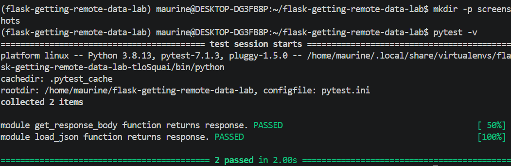

# Getting Remote Data Lab

## Overview

This project demonstrates how to retrieve remote data from an API using Python. It implements a reusable `GetRequester` class that accepts a URL, sends an HTTP GET request, and converts JSON responses into Python data structures.

The project uses the `requests` library for HTTP requests and Python's built-in `json` module for JSON parsing.

## Remote API Endpoint

The application retrieves data from the following endpoint:

`https://learn-co-curriculum.github.io/json-site-example/endpoints/people.json`

The endpoint returns a list of people with information such as their names and occupations.

## Features

The `GetRequester` class provides two main methods:

### `get_response_body()`

Sends an HTTP GET request to the URL supplied when the class is initialized and returns the raw response body.

```python
requester = GetRequester(url)
response = requester.get_response_body()
```

### `load_json()`

Uses the response from `get_response_body()` and converts the JSON data into Python data structures.

```python
data = requester.load_json()
```

The returned JSON is converted into a Python list containing dictionaries.

## Example

```python
from lib.GetRequester import GetRequester

url = "https://learn-co-curriculum.github.io/json-site-example/endpoints/people.json"

requester = GetRequester(url)

data = requester.load_json()

print(data)
```

Example output:

```text
[
    {'name': 'Daniel', 'occupation': 'LG Fridge Salesman'},
    {'name': 'Joe', 'occupation': 'WiFi Fixer'},
    {'name': 'Avi', 'occupation': 'DJ'},
    {'name': 'Howard', 'occupation': 'Mountain Legend'}
]
```

## Technologies Used

* Python 3.8.13
* Requests
* JSON
* Pytest
* Pipenv

## Project Structure

```text
flask-getting-remote-data-lab/
├── lib/
│   ├── GetRequester.py
│   └── testing/
├── Pipfile
├── Pipfile.lock
├── pytest.ini
└── README.md
```

## Setup

Clone the repository and navigate into the project:

```bash
git clone https://github.com/123Mwanjira/flask-getting-remote-data-lab.git
cd flask-getting-remote-data-lab
```

Install the project dependencies:

```bash
pipenv install
```

Activate the virtual environment:

```bash
pipenv shell
```

## Running the Tests

Run the automated test suite with:

```bash
pytest -v
```

The completed implementation passes all tests:

```text
2 passed
```

## Git Workflow

The implementation was developed on the `feature-get-requester` branch before being merged into `main`.

## Lab Requirements Completed

* [x] Build a reusable `GetRequester` class
* [x] Accept a URL during initialization
* [x] Send an HTTP GET request
* [x] Return the raw response body
* [x] Convert JSON data into Python data structures
* [x] Add explanatory code comments
* [x] Test the implementation with Pytest
* [x] Document the completed functionality
### Test Results

The automated test suite passes successfully:



## Author

Maurine Gichuhi
